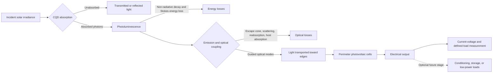
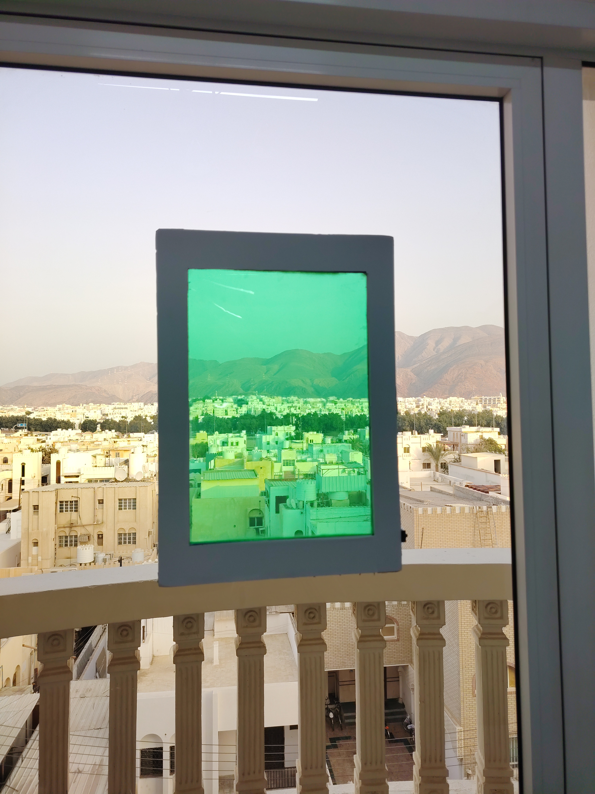
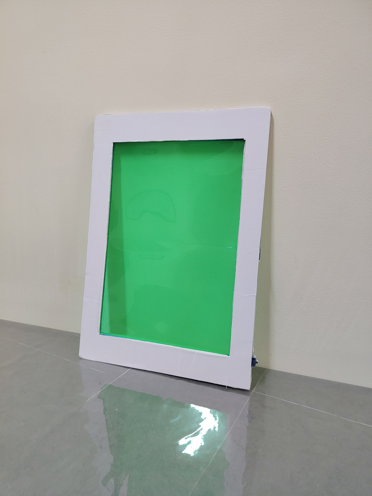

# AETHER
<p align="center">
  
</p>

<h1 align="center">AETHER</h1>

<p align="center">
  <strong>A Window That Generates Electricity</strong><br>
  <strong>Invisible energy → visible impact.</strong>
</p>

<p align="center">
  Carbon-quantum-dot luminescent solar concentrator research for transparent solar windows,<br>
  building-integrated photovoltaics, sustainable buildings, and student engineering in Oman.
</p>

---

AETHER is an early-stage **transparent solar-window research project** investigating whether architectural glass can convert part of the sunlight falling on it into useful electricity while retaining useful daylight transmission. The proposed system combines food- or agricultural-waste-derived **carbon quantum dots (CQDs)**, a transparent luminescent interlayer, optical guidance through glass, and narrow photovoltaic (PV) cells around the perimeter.

Unlike an ordinary opaque solar panel, AETHER is intended to keep the PV material largely outside the main viewing area. Its operating concept belongs to the established field of **luminescent solar concentrators (LSCs)**: absorb selected incident photons, re-emit light through photoluminescence, guide a fraction of that light to the edges, and convert it into electricity there. Every stage loses energy; the design does not create energy from nothing, and it is not expected automatically to outperform conventional PV modules.

> **Project status — research concept with a built, non-working presentation prototype; reviewed 23 October 2026.**  
> The project architecture, presentations, research direction, and a framed, non-working prototype are documented. The supplied records do **not** contain measured CQD spectra, measured visible-light transmittance or haze, calibrated edge-optical measurements, or electrical output from a complete AETHER device. **A working electricity-generating AETHER window has not yet been demonstrated.** The approximately 690 nm emission, specialised edge-cell performance, and 20–25-year service life discussed below are design targets or research ambitions—not measured results.

## Table of Contents

- [The Vision Behind AETHER](#the-vision-behind-aether)
- [My Project Story](#my-project-story)
- [The Problem](#the-problem)
- [Mission and Objectives](#mission-and-objectives)
- [Why Oman?](#why-oman)
- [How AETHER Works](#how-aether-works)
- [Scientific Context and Prior Art](#scientific-context-and-prior-art)
- [Materials and System Architecture](#materials-and-system-architecture)
- [The Role of Carbon Quantum Dots](#the-role-of-carbon-quantum-dots)
- [Technical Innovations and Design Contributions](#technical-innovations-and-design-contributions)
- [Prototype and Current Development Stage](#prototype-and-current-development-stage)
- [Experimental Validation Plan](#experimental-validation-plan)
- [Performance Metrics and Engineering Trade-offs](#performance-metrics-and-engineering-trade-offs)
- [Potential Applications](#potential-applications)
- [Sustainability and Environmental Impact](#sustainability-and-environmental-impact)
- [Challenges, Limitations, and Open Research Questions](#challenges-limitations-and-open-research-questions)
- [Development Roadmap](#development-roadmap)
- [Project Journey, Outreach, and Recognition](#project-journey-outreach-and-recognition)
- [Repository Structure](#repository-structure)
- [Founder and Acknowledgements](#founder-and-acknowledgements)
- [How to Contribute](#how-to-contribute)
- [Future Collaboration and Contact](#future-collaboration-and-contact)
- [License and Confidentiality](#license-and-confidentiality)
- [References and Further Reading](#references-and-further-reading)
- [Final Summary](#final-summary)

---

## The Vision Behind AETHER

Buildings already require surfaces that admit daylight, provide views, and protect interior spaces. AETHER asks whether some of those surfaces could eventually perform a second function: **distributed renewable-electricity generation without making every energy-generating surface look like a conventional rooftop panel**.

The long-term vision is a glazing element in which a transparent optical layer harvests a selected part of the incident spectrum while perimeter electronics handle conversion and, potentially, local low-power loads. If future evidence supports the concept, related architectures could be investigated for homes, schools, offices, commercial buildings, public facilities, and selected glazed infrastructure.

That vision must preserve more than electricity output. A useful solar window must also be judged by:

- **Window function:** daylight, view, colour, clarity, haze, glare, and occupant comfort.
- **Architectural integration:** dimensions, framing, wiring, safety, maintenance, and appearance.
- **Energy performance:** measured output under realistic illumination, orientation, shading, and temperature.
- **Durability:** stability of the luminophore, host, interfaces, seals, PV cells, and electronics.
- **Lifecycle performance:** material inputs, fabrication energy, repair, replacement, and end of life.
- **System value:** whether the electricity and additional functions justify added cost and complexity.

AETHER is therefore a **complementary building-integrated-photovoltaics research direction**, not a proposal to replace all conventional solar panels.

## My Project Story

My interest in engineering became hands-on when I was in Grade 6, after my father gave me a basic electronics kit. Experimenting with electronics made me curious about how hardware, software, and energy systems could be combined to solve practical problems. AETHER developed from that same habit of asking whether an ordinary object could perform an additional useful function.

The immediate idea came from an everyday observation. After seeing an electricity bill and then noticing the large glazed area of a nearby building, I wondered: **what if those windows could help generate electricity?** I recorded the idea and developed it for the Middle East College Sustainability Hackathon under the name **AURS — Advanced Ultraviolet Resonance Sequestrator**. The early concept explored UV-responsive organic materials derived from agricultural waste, luminescent re-emission, internal reflection, and edge-mounted solar cells.

I later presented a developed version at the Indian School Muscat Techathon under the name **AETHER**. I did not receive an award at either event, but the experience was important. It made the gap between an attractive presentation and a demonstrable engineering system much clearer. In particular, I had to confront questions about material degradation, optical losses, prototype construction, electrical measurement, cost, and whether the design could survive as an architectural product. My notes also record an early attempt to demonstrate a vibration-assisted window-cleaning idea; its power source stopped working, and the available description is not sufficient to establish how it was powered. It is not claimed here as a working AETHER feature or as evidence of solar electricity generation.

My first material direction was to use organic luminescent pigments associated with food or agricultural waste. As I investigated the concept further, I became concerned that some organic luminophores could photodegrade under prolonged ultraviolet exposure. This was a **design review and research concern**, not a lifetime measurement performed on an AETHER sample. It led me to reconsider the material platform rather than defend the original idea simply because it was mine.

The next step was a pivot toward **carbon quantum dots**. CQDs attracted my attention because they can be made from carbon-rich precursors, including biomass in published research, and because their optical properties can be investigated within an LSC. This pivot happened after the two earlier hackathon presentations. It did not settle the durability question: CQD photostability and encapsulation must still be tested in the final solid host, and a waste-derived precursor does not automatically make a product sustainable.

I then began treating AETHER as a coupled optical, materials, and electrical system rather than only a window concept. My current design research includes a proposed deep-red emission target around 690 nm, investigation of compatible edge-PV options, transparent-host dispersion and encapsulation, and the possibility of measuring or using small amounts of electricity locally in the window frame. These are **design contributions and hypotheses**, not experimentally established improvements.

The name AETHER references the historical idea of an unseen medium associated with light. I gave it a project-specific meaning: investigating how energy in sunlight that people normally cannot see might be converted into a useful, visible outcome. The tagline is **“Invisible energy → visible impact.”**

The most important lesson so far is that a convincing project must be willing to measure its own weaknesses. I still need to establish whether a suitable CQD material can be produced reproducibly, whether it remains clear and luminescent in a host, whether useful light reaches the edges, and whether the complete system delivers measurable power to a load. My next goal is therefore not to claim a finished product. It is to build and test a defensible proof of the complete optical-to-electrical chain, learn from negative results, and improve the design from evidence.

## The Problem

Buildings account for around 30% of global energy demand, making the relationship between building surfaces, energy use, and clean-energy integration an important research area [1]. At the same time, windows are not empty energy collectors: they already provide daylight, views, ventilation in some configurations, weather protection, and architectural value.

Conventional opaque PV modules can be mounted on rooftops and can also be integrated into some façades. What they generally cannot do is serve as **see-through vision glass**. Transparent and semi-transparent PV technologies investigate this additional integration route, but they introduce coupled optical and electrical constraints [2].

The specific opportunity explored by AETHER is therefore not “windows receive sunlight, so all of that energy is being wasted.” The real engineering question is more demanding:

> **Can a glazing system harvest a useful fraction of incident optical energy while preserving acceptable window performance, and can it do so with sufficient durability, safety, and lifecycle value?**

### Why the problem is difficult

1. **The incident spectrum is finite and wavelength-dependent.** Only photons within the absorber's useful absorption range can drive the proposed photoluminescent pathway. The spectrum reaching an actual vertical window also depends on location, orientation, atmosphere, external shading, and any upstream glazing or coating.
2. **Transparency and absorption compete.** Increasing absorber loading may increase captured photons but can also reduce visible-light transmittance, alter colour, or increase haze.
3. **Absorption is not electricity.** The absorbed energy must survive photoluminescence, optical transport, edge coupling, PV conversion, and electrical conditioning.
4. **Architectural geometry is unfavourable for simple assumptions.** Windows may be vertical, partially shaded, hot, dusty, or viewed from oblique angles. Laboratory values at normal incidence do not automatically describe annual performance.
5. **UV is not a free, uniform energy reservoir.** Standard glass and coatings may already attenuate parts of the UV spectrum. The proposed design must measure the irradiance actually available at the luminescent layer rather than assume that all transmitted or reflected UV can be recovered efficiently.
6. **A window must remain a window.** Colour neutrality, haze, clarity, glare, thermal behaviour, safety, and maintainability can be as important as electrical output.
7. **The correct benchmark is not one-dimensional.** AETHER should eventually be compared with ordinary glazing, ordinary glazing plus separate conventional PV, semi-transparent PV, and other LSC designs using explicit optical, electrical, economic, and lifecycle boundaries.

This is why AETHER is framed as an investigation, not as a guaranteed solution to building-energy demand.

## Mission and Objectives

### Mission

**To investigate whether waste-derived carbon quantum dots and luminescent solar-concentrator architecture can enable a transparent or semi-transparent window to deliver measurable electrical output while preserving useful glazing functions—and to document both positive and negative evidence honestly.**

### Work completed or documented

- Defined the original window-energy concept and developed it through the AURS and AETHER presentations.
- Established an initial system-level research architecture covering absorption, emission, waveguiding, edge-PV conversion, and possible electrical use.
- Reviewed the limitations of the initial organic-pigment direction and identified CQDs as a new research direction.
- Developed project presentations, visualisations, a framed, non-working prototype, and an interactive presentation website; the website is not included in this repository.
- Presented earlier versions at the Middle East College Sustainability Hackathon and Indian School Muscat Techathon.
- Defined a proposed 690 nm emission target and identified the need for spectral and edge-PV compatibility studies.
- Established the need for controlled optical, electrical, and durability validation.

These items document concept development and communication; they do not constitute experimental validation.

### Current research objectives

- Select a feasible CQD precursor, synthesis, purification, and characterisation pathway with qualified laboratory guidance.
- Identify a transparent host and encapsulation approach compatible with CQD dispersion, optical clarity, and environmental stability.
- Measure absorption, excitation, emission, and absolute photoluminescence quantum yield in the relevant host.
- Compare baseline glass, blank-host, and CQD-modified samples.
- Investigate optical transport to the perimeter and the effect of sample geometry.
- Establish a silicon-PV baseline before evaluating more specialised edge-cell alternatives.
- Build an instrumented small-scale proof of the complete optical-to-electrical chain.
- Develop safe, repeatable measurement records that another researcher could reproduce.

### Future objectives, contingent on earlier evidence

- Quantify visible-light transmittance, haze, colour, edge optical power, PV current–voltage behaviour, and load power.
- Evaluate UV, thermal, humidity, dust, and combined environmental ageing appropriate to the intended installation.
- Compare performance with relevant transparent-PV and LSC alternatives.
- Assess locally available feedstocks in Oman subject to consistency, safety, and lifecycle analysis.
- Investigate autonomous low-power sensing only after net available energy has been measured.
- Assess manufacturing scale-up, glazing integration, safety, cost, and end-of-life pathways.

## Why Oman?

AETHER is a student-led project developed in Muscat, Oman. Its local relevance comes from the intersection of solar-energy research, sustainable buildings, materials innovation, and the development of research capabilities—not from any official adoption or endorsement.

Oman Vision 2040 lists **Education, Learning, Scientific Research and National Capabilities** and **Environment and Natural Resources** among its national priorities. Its official environment materials also refer to renewable natural resources for energy production and to development of the waste sector [3]. AETHER relates to those themes as an independent student research project:

- **Research and capability development:** it connects optics, nanomaterials, electronics, architecture, and experimental method.
- **Clean-energy investigation:** it explores a possible additional form of distributed solar-energy harvesting, subject to proof of feasibility.
- **Sustainable-building research:** it treats glazing as a multifunctional building component rather than considering electricity alone.
- **Responsible resource use:** it asks whether suitable waste-derived carbon precursors could have higher-value uses, while requiring full assessment of processing and end of life.

Oman's solar resource, documented through Global Solar Atlas country data, makes solar-energy research locally relevant [4]. That does not establish the output of a vertical AETHER window. Site-specific irradiance, window orientation, shading, temperature, dust, and installation geometry must be measured or modelled.

### Possible future relevance in Oman

If controlled testing eventually establishes useful performance, suitable variants could be investigated for:

- school and university buildings that also serve as education and demonstration sites;
- offices and public buildings with appropriately designed glazing;
- commercial developments where façade integration has architectural value;
- selected low-power environmental monitoring or smart-building functions; and
- research into locally appropriate, durable glazing materials.

These are **potential applications**, not deployments. Heat, intense UV exposure, dust deposition, humidity where relevant, maintenance access, and glazing safety are design constraints rather than afterthoughts.

### Local feedstock research

Locally available agricultural or food residues could be screened as possible CQD precursors only after establishing:

1. a consistent and legally available feedstock stream;
2. composition and batch variability;
3. the yield and reproducibility of the desired optical material;
4. chemical, solvent, water, and energy requirements;
5. toxicity, purification, waste handling, and worker safety; and
6. transport, durability, and end-of-life effects.

No local feedstock has yet been selected or validated for AETHER. “Locally waste-derived” and “sustainable” are separate claims requiring separate evidence.

### SDG connection map

The following is a **project-authored Sustainable Development Goal (SDG) mapping**, not a statement of United Nations (UN) affiliation, certification, funding, or endorsement. Goal names follow the official UN framework [5].

| SDG | Specific connection to AETHER | Nature of connection |
|---|---|---|
| **7 — Affordable and Clean Energy** | Investigates a possible route to distributed renewable electricity from architectural glazing. | **Intended future direct contribution**; no electricity output has yet been validated. |
| **9 — Industry, Innovation and Infrastructure** | Develops student research, materials–optics–electronics integration, and an experimental methodology. | **Direct research and innovation activity**; infrastructure deployment is future and unproven. |
| **11 — Sustainable Cities and Communities** | Explores multifunctional glazing that could combine daylighting with local energy generation. | **Intended future contribution**, contingent on technical and architectural feasibility. |
| **12 — Responsible Consumption and Production** | Investigates waste-derived precursors and emphasises durability, material inputs, and end of life. | **Indirect at present; intended future contribution**; sustainability must be demonstrated by lifecycle evidence. |
| **13 — Climate Action** | Explores renewable-energy technology that could contribute to lower operational emissions if net benefits are established. | **Indirect and prospective**; no emissions reduction or carbon saving is claimed. |

AETHER does not claim to solve Oman's energy challenges. Its present contribution is a research question and a documented attempt to develop the skills and evidence needed to answer it.

## How AETHER Works

AETHER proposes a luminescent solar-concentrator pathway. LSCs and their use with edge-mounted PV cells are established research concepts [6–8]. AETHER's proposed implementation must still be demonstrated stage by stage.



**Text fallback:**

`Incident sunlight → selective absorption → photoluminescent re-emission → partial waveguiding → edge-PV conversion → measured electrical output`

Side paths at every stage include transmission, reflection, heat, escape-cone emission, scattering, reabsorption, parasitic absorption, optical-coupling loss, PV loss, and electrical loss.

### Stage-by-stage explanation

| Stage | Function and scientific principle | Main constraints and losses | What must be demonstrated for AETHER |
|---|---|---|---|
| **1. Incident light** | Solar irradiance supplies the input optical power. Its spectral distribution and angle determine which photons reach the active layer. | Reflection, upstream glazing absorption, orientation, shading, dust, and spectrum variation. | Calibrated plane-of-window irradiance and, where possible, spectral irradiance at the actual sample. |
| **2. Optical absorption** | CQDs absorb photons within their absorption bands, promoting energy into excited states. | Incomplete absorption, visible-light attenuation, colour, scattering, and absorption by the host or impurities. | Absorption and transmission spectra relative to blank glass and blank-host controls. |
| **3. CQD photoluminescence** | Some excited states emit photons, normally at longer wavelength and lower photon energy than the absorbed photons. | Non-unity photoluminescence quantum yield (PLQY), non-radiative decay, Stokes-energy loss, spectral drift, and photodegradation. | Corrected excitation/emission spectra, absolute PLQY in the final host, and repeatability across batches. |
| **4. Optical propagation and confinement** | A fraction of isotropically emitted light enters guided modes and can travel through a higher-refractive-index waveguide by total internal reflection (TIR). | Escape-cone loss, reabsorption, scattering, host absorption, surface defects, interface loss, and longer path lengths in larger samples. | Calibrated edge spectra and optical power as a function of illumination position and sample geometry. |
| **5. Edge optical collection** | Perimeter PV cells receive part of the guided luminescence through an optical interface. | Edge reflection, poor cell coverage, adhesive or interface absorption, non-uniform illumination, and spectral mismatch. | Optical coupling measurement and comparison of edge-PV response with appropriate controls. |
| **6. Photovoltaic conversion** | The PV cells absorb suitable photons and convert part of their energy into direct-current (DC) electrical power. | PV quantum efficiency, recombination, voltage losses, fill factor, series/shunt resistance, temperature, and wiring loss. | Full current–voltage (I–V) curves and maximum power to a defined load under stated irradiance and temperature. |
| **7. Conditioning, storage, or loads** | Optional electronics could measure, regulate, store, or deliver energy to suitable low-power devices. | Conversion overhead, quiescent current, battery losses, self-discharge, safety, and insufficient net energy. | Net energy balance at the load, including all electronics and storage losses. This stage is currently proposed only. |

### Total internal reflection: necessary but not sufficient

For light travelling from a higher-index medium to a lower-index medium, TIR occurs above the critical angle:

`θc = sin⁻¹(nout / nin)`, where `nin > nout`.

For an ideal isotropic emitter inside a lossless slab with `nin ≈ 1.5` surrounded by air, the critical angle is approximately 41.8°, and the simple two-face escape-cone model gives an ideal guided fraction of roughly 75%. This is an **illustrative ideal-slab estimate**, not an AETHER measurement. Real interlayers, coatings, emission locations, surface roughness, reabsorption, scattering, and interfaces change the result [6–8].

Light can therefore undergo TIR without delivering useful edge power. The complete quantity of interest is the calibrated optical power reaching the PV cells after all transport losses.

### The proposed 690 nm emission and its 1.80 eV equivalent

The photon-energy relationship is:

`Eγ = hc / λ`

Using SI constants and expressing wavelength in nanometres [9]:

`Eγ (eV) = 1239.841984… / λ (nm)`

For a **target** wavelength of 690 nm:

`Eγ = 1239.841984… / 690 = 1.79687… eV ≈ 1.80 eV`

This calculation establishes only the energy of a photon with that vacuum wavelength. It does **not** establish that:

- an AETHER CQD sample emits at 690 nm;
- 690 nm is the measured peak of a broad or excitation-dependent spectrum;
- the material has a high PLQY or low reabsorption;
- the emitted photon flux or optical power is useful;
- a PV cell with a nominally similar bandgap will operate efficiently; or
- the complete window will have a high solar-to-electrical efficiency.

A PV cell must be evaluated against the **entire measured emission spectrum**, its own absorption and external quantum efficiency, optical thickness, operating voltage, and fill factor. Setting a bandgap equal to a rounded photon energy does not eliminate thermalisation, reflection, incomplete absorption, recombination, resistive loss, or the voltage deficit. Indeed, 1.79687 eV rounds to 1.80 eV; the unrounded values and actual band edges still matter.

Silicon is not excluded from consideration simply because it has a fixed bandgap. It can absorb 690 nm photons and should serve as a practical baseline. Specialised III–V or perovskite cells may be investigated later, but they introduce their own cost, fabrication, stability, safety, and integration questions. No AETHER edge-cell efficiency has been established.

### Photon energy, optical power, electrical power, and energy yield are different

- **Photon energy** is energy per photon, measured here in electronvolts (eV).
- **Photon flux** is photons per unit time. For approximately monochromatic light, `Popt = Φγhc/λ`, where `Φγ` is photon flux.
- **Optical power** is radiant energy per unit time, measured in watts (W).
- **Electrical power** delivered at an operating point is `P = VI`, also in watts.
- **Energy yield** is power integrated over time: `Eel = ∫Pel(t)dt`, reported in joules or watt-hours.
- **Efficiency** is a ratio of useful output to a clearly defined input over the same boundary and interval.

A bright fluorescence photograph shows neither optical power nor electrical power. An open-circuit voltage shows neither maximum power nor energy yield.

## Scientific Context and Prior Art

AETHER should be understood within—not outside—the existing scientific literature.

| Established field or prior art | What already exists | Relationship to AETHER |
|---|---|---|
| **Luminescent solar concentrators** | LSC research has investigated luminescent waveguides and edge-mounted PV cells for decades [6–8]. | AETHER uses this established operating architecture; the broad concept is not claimed as original. |
| **Transparent and semi-transparent photovoltaics** | Multiple wavelength-selective and partially transmitting PV approaches have been studied, with established figures of merit and integration trade-offs [2]. | AETHER is one alternative within the wider solar-window research landscape and must be compared fairly with other approaches. |
| **Carbon-dot LSCs** | Experimental CQD-based laminated LSCs and related optical studies have already been published [10,11]. | Investigating CQDs in an LSC is not, by itself, a novel AETHER invention. |
| **CQD synthesis and optical materials** | CQD synthesis, functionalisation, photoluminescence, and applications are a substantial research field [12]. | AETHER must characterise its own material rather than assume literature properties transfer to a new formulation. |
| **Biomass-derived carbon dots** | Biomass can be a carbon precursor, but sustainability depends on the complete synthesis and purification pathway [13]. | AETHER's waste-derived direction is a materials research choice, not proof of environmental superiority. |

### Where the project's own contributions currently lie

The documented AETHER-specific work is the **particular combination and evolution of design decisions**: the pivot from an initial organic-pigment concept to waste-derived CQD research, a proposed deep-red spectral target, attention to host encapsulation, perimeter-PV system architecture, construction of a non-working presentation prototype, and a proposed frame-local measurement/storage architecture.

No freedom-to-operate analysis, patent search, or comprehensive novelty proof has been supplied. Accordingly, this README uses terms such as **design contribution**, **adaptation**, **research direction**, and **proposed approach**, rather than “breakthrough,” “unprecedented,” or “patentable.”

## Materials and System Architecture

The envisioned full system differs from the current framed, non-working prototype. The table below separates documented design intent from verified implementation.

| Subsystem | Intended role | Current specification and implementation status |
|---|---|---|
| **Transparent substrate / glazing** | Provides the architectural surface and, in the envisioned design, participates in optical guidance. | The full-system substrate is proposed. The exact material, thickness, refractive index, dimensions, and glazing construction of the prototype have not been established from the supplied evidence. |
| **Luminescent interlayer or coating** | Holds CQDs and couples emitted light into guided optical modes. | **Proposed.** Embedded/interlayer and coated approaches require comparison; no validated AETHER CQD layer is documented. |
| **Waste-derived CQDs** | Absorb selected incident photons and re-emit lower-energy photons. | **Proposed research direction.** No AETHER synthesis batch, purification record, structural characterisation, or measured spectrum has been supplied. |
| **Transparent host and encapsulation** | Disperse CQDs, limit aggregation and scattering, and protect against environmental exposure. | **Proposed.** Optical hosts based on poly(methyl methacrylate) (PMMA, commonly called acrylic) or polycarbonate, together with coating versus bulk-casting routes, have been discussed as candidates in project descriptions. No final host, formulation, loading, surface treatment, or seal design has been selected or validated. |
| **Optical interfaces and perimeter geometry** | Transport edge-directed light into PV cells with minimal reflection and absorption. | **Proposed.** Edge preparation, adhesive, cell coverage, and optical coupling have not been validated. |
| **Perimeter PV cells** | Convert edge-received luminescence into DC electricity. | **Proposed.** Silicon is the required baseline. AlGaAs/GaAs-family and perovskite options discussed in early design notes remain unselected research candidates. No functional AETHER edge-PV array is documented. |
| **Wiring and measurement** | Record current, voltage, power, and operating conditions without introducing unaccounted losses. | **Proposed.** No calibrated circuit or dataset is documented. |
| **Power management and storage** | Optional charging, regulation, and local energy storage for suitable low-power loads. | **Proposed future subsystem.** Component selection, protection, net energy balance, and safety require engineering and testing. |
| **External load or sensing function** | Demonstrate useful delivered energy rather than voltage alone. | **Proposed.** No load has been demonstrated as powered by the complete AETHER optical-to-electrical pathway. |

No exact concentrations, synthesis temperatures, dimensions, suppliers, cell part numbers, or circuit values are inferred in this document. Where those details become necessary for reproducibility, they should be added only after verification and after the project lead decides what is suitable for public disclosure.

## The Role of Carbon Quantum Dots

### Why CQDs are being investigated

CQDs are a family of nanoscale carbon-based materials whose optical behaviour depends on factors including precursor chemistry, formation process, size and structure, surface groups, defects, purification, and local environment [12]. In an LSC, their intended functions are to absorb selected incident light and re-emit photons that can be transported to edge PV cells. CQD-based LSCs are already an active research field [10,11].

For AETHER, CQDs are attractive as a **research candidate** because they offer a possible connection between carbon-rich biomass and luminescent materials. They are not attractive merely because the words “carbon,” “quantum,” or “waste-derived” sound sustainable. Their value must be established through optical performance, durability, safety, and lifecycle evidence.

### Synthesis and feedstock questions

Published biomass-derived carbon-dot routes use different precursors and processing methods. Translating that literature into AETHER requires answers to the following:

- Can the selected feedstock produce a reproducible optical material rather than a variable mixture?
- Which components of the feedstock contribute to the desired absorption and emission?
- What purification is required to remove molecular fluorophores, unreacted material, and by-products?
- Are the measured optical properties actually associated with the purified CQDs rather than impurities?
- Can batch-to-batch variation be controlled at the scale required for a uniform window?
- Are any solvents, dopants, surface treatments, or residues compatible with safety and lifecycle goals?

No AETHER feedstock or process has yet passed these checks. Detailed process development belongs in an appropriately equipped and supervised laboratory.

### Optical properties that must be measured

1. **Absorption spectrum:** establishes which incident wavelengths can be harvested; transmission alone may not separate absorption from reflection and scattering.
2. **Excitation spectrum:** identifies which excitation wavelengths produce the relevant emission.
3. **Emission spectrum:** establishes the actual peak, width, shape, and excitation dependence. A 690 nm target is not a substitute for this measurement.
4. **Photoluminescence quantum yield:** `PLQY = emitted photons / absorbed photons`, ideally measured absolutely with an integrating sphere under stated conditions.
5. **Stokes shift:** the separation between a defined absorption feature and the emission peak. With broad CQD spectra, the reporting convention matters. In energy terms, `ΔE = Eabs − Eem`.
6. **Spectral stability:** checks peak and intensity changes over time, excitation exposure, temperature, and ageing.
7. **Absorption–emission overlap:** indicates potential reabsorption. A large Stokes shift can reduce overlap, but broad absorption tails can still cause losses [11].
8. **Solid-state behaviour:** PLQY and emission in solution cannot be assumed to remain unchanged after dispersion and curing in the final host.

### Dispersion, transparency, and reabsorption

CQDs must be distributed without harmful aggregation. Aggregation or incompatible surface chemistry can change emission, reduce PLQY, and scatter visible light. Higher loading can increase absorption but may also increase haze, colour, reabsorption, and brittleness or other host changes.

Reabsorption occurs when an emitted photon is absorbed again before escaping or reaching an edge. Each additional absorption–emission cycle creates further opportunities for non-radiative loss and escape-cone loss. Optical path length therefore matters: a design that works in a small coupon may perform differently when scaled to a larger pane [8,11].

### Durability is formulation-specific

It would be incorrect to claim that CQDs automatically last 20–25 years, or that all organic luminophores fail quickly while all CQDs remain stable. The relevant system is the **CQD + host + interface + encapsulation + exposure environment**. Oxygen, moisture, UV dose, heat, thermal cycling, and mechanical stress can affect different parts of that system.

AETHER's 20–25-year figure is a service-life ambition only. Accelerated testing must be linked carefully to real exposure, and accelerated results must not be converted directly into years without a defensible ageing model.

### Waste-derived does not automatically mean environmentally benign

A complete assessment must include precursor collection, washing, chemical conversion, solvents, purification, energy use, process yield, consumables, by-products, toxicity, transport, host production, PV materials, and disposal. Reviews of carbon-dot sustainability specifically identify solvent use, energy demand, material efficiency, purification, safety, and waste management as important issues [13].

Accordingly, AETHER makes no claim of non-toxicity, carbon neutrality, waste-diversion benefit, or lifecycle superiority at this stage.

## Technical Innovations and Design Contributions

The following entries document the project lead's design decisions without presenting established scientific principles as new discoveries.

### 1. Pivot from organic waste-derived pigments to CQD research

- **Problem addressed:** The initial material direction raised concerns about prolonged UV exposure and architectural durability.
- **Proposed approach:** Replaced the initial organic-pigment research direction with investigation of CQDs derived from carbon-rich food or agricultural residues.
- **Scientific rationale:** CQDs can exhibit useful photoluminescence and have already been investigated in LSCs; their surface chemistry and host environment provide design variables [10–12].
- **Expected benefit:** A potentially more durable and tunable luminescent layer, if suitable solid-state optical properties and ageing behaviour are demonstrated.
- **Current status:** **Proposed research direction; design pivot documented.**
- **Evidence needed:** Reproducible synthesis, purification, structural and optical characterisation, solid-host PLQY, and comparative ageing against the original approach.
- **Limitations:** The durability concern with the first route was not measured on an AETHER pigment sample, and CQD longevity is not guaranteed. Novelty is not claimed for CQD-LSCs generally.

### 2. Embedded CQD-host interlayer with protective encapsulation

- **Problem addressed:** A luminescent material must remain optically clear, well dispersed, and coupled to the waveguide while resisting environmental exposure.
- **Proposed approach:** Investigate uniform CQD incorporation into a transparent interlayer, followed by suitable encapsulation, rather than relying only on an exposed surface pigment.
- **Scientific rationale:** Host chemistry and interfaces influence aggregation, scattering, emission, refractive-index contrast, and ingress of oxygen or moisture.
- **Expected benefit:** Improved optical uniformity and potentially better environmental protection and handling.
- **Current status:** **Proposed.** No validated AETHER CQD-host interlayer is documented.
- **Evidence needed:** Blank-host controls, dispersion and haze measurements, refractive-index data, emission mapping, adhesion testing, and aged optical performance.
- **Limitations:** Embedding a luminophore does not automatically improve TIR or PLQY; the host can quench emission or absorb/scatter light. Coated and laminated alternatives should remain open for comparison.

### 3. Spectral co-design around a 690 nm target

- **Problem addressed:** Edge-PV conversion depends on the wavelength and power of the light actually delivered to the cells.
- **Proposed approach:** Investigate a deep-red emission target around 690 nm and evaluate PV candidates against the measured spectrum rather than selecting cells independently of the luminophore.
- **Scientific rationale:** Spectral matching affects absorption and external quantum efficiency; reduced absorption–emission overlap may also help if the full spectra support it.
- **Expected benefit:** Better use of edge-delivered photons and a rational basis for comparing silicon with specialised PV options.
- **Current status:** **Proposed target.** No measured AETHER emission peak or selected edge cell exists in the supplied evidence.
- **Evidence needed:** Corrected emission spectra, optical power at the edge, PV external quantum efficiency, and full I–V measurements under monochromatic and solar-relevant excitation.
- **Limitations:** The 690 nm value does not prove low reabsorption, high PLQY, or high efficiency. Exact formulation and device configuration remain open, and silicon must not be ruled out without measurements.

### 4. Perimeter-PV framing that preserves a central viewing aperture

- **Problem addressed:** Covering the entire glazing area with opaque PV would conflict with the window's view and daylight functions.
- **Proposed approach:** Keep PV strips around the perimeter and use the central transparent area for optical collection.
- **Scientific rationale:** This is the established LSC strategy of separating the large optical collection area from the smaller PV conversion area [6–8].
- **Expected benefit:** PV components could remain largely outside the main viewing area and within a frame.
- **Current status:** **Non-working presentation prototype Built; functional edge-PV system Proposed.**
- **Evidence needed:** Documented cell geometry, calibrated edge illumination, complete optical-to-electrical measurements, and visible-aperture/transmittance measurements.
- **Limitations:** This architecture is prior art rather than a new AETHER invention. Perimeter length, frame shading, wiring, and edge-cell area can become limiting as pane size increases.

### 5. Frame-local measurement, storage, and low-power use

- **Problem addressed:** Small and variable window-level output may be poorly matched to immediate grid export, while additional building wiring can add cost and complexity.
- **Proposed approach:** Investigate local current/voltage measurement, protected charging, storage, regulation, and suitable low-power sensing within or near the frame.
- **Scientific rationale:** Matching a load to measured energy availability can make a small source useful; local operation may reduce dependence on remote electronics.
- **Expected benefit:** A possible autonomous window-level demonstrator and a clear way to measure net useful energy.
- **Current status:** **Proposed electrical architecture.** No assembled or powered AETHER system is documented.
- **Evidence needed:** Circuit and safety review, quiescent-power budget, round-trip storage efficiency, load profiles, and multi-day net-energy measurements.
- **Limitations:** Electronics and batteries consume or store energy imperfectly and can outweigh a very small source. Detailed circuit values and any unpublished implementation choices are intentionally not reconstructed here.

## Prototype and Current Development Stage

### What the photographs establish

The repository contains photographs of the framed, green-tinted, non-working prototype I constructed for presentations. They document physical fabrication and appearance and provide a useful reference for discussing form factor and visibility through a central aperture.

| Non-working prototype photographed against a window | Non-working prototype photographed indoors |
|:---:|:---:|
|  |  |

*Project photographs supplied in the repository. They are evidence of a non-working prototype, not evidence of CQD composition, photoluminescence, waveguiding, PV conversion, or electricity generation.*

The images alone do not establish the central sheet's material, the presence or absence of CQDs, any hidden component, the optical spectrum, the existence of functional perimeter PV cells, or successful performance. No such hidden functionality is inferred in this README.

### Status definitions

- **Proposed:** documented as an idea, design, target, or planned experiment; not yet implemented as stated.
- **In Progress:** active documented work exists, but the component or research question remains incomplete.
- **Built:** a physical artifact exists; this label says nothing by itself about functionality.
- **Tested:** a defined measurement has been performed and a usable record is available.
- **Validated:** controlled evidence, including appropriate comparisons and uncertainty, supports the specific claim.

### Component and evidence matrix

| Component or feature | Status | Available evidence | Next validation step |
|---|---|---|---|
| Concept and system-level research architecture | **In Progress** | Project descriptions, presentations, and literature-informed design documentation. | Maintain a referenced design baseline and revise it against experimental results. |
| Framed, non-working presentation prototype | **Built** | `PIC1.jpg` and `PIC2.jpg`; confirmation from the project lead. | Record materials, dimensions, fabrication steps, and the intended role of each component. |
| Waste-derived CQD batch | **Proposed** | Research direction only; no characterised AETHER batch documented. | Synthesise and purify under qualified supervision; characterise structure and optical behaviour. |
| CQD luminescent interlayer | **Proposed** | Design concept; no verified CQD layer in the photographs. | Prepare blank-host and CQD-host coupons and compare spectra, haze, and uniformity. |
| Approximately 690 nm emission | **Proposed** | Photon-energy calculation only; no AETHER emission spectrum. | Measure corrected excitation and emission spectra in the final host. |
| Optical guidance to edges | **Proposed** | Established LSC principle; no AETHER edge-optical dataset. | Measure calibrated edge spectra and optical power against controls. |
| Perimeter PV array | **Proposed** | Architectural design; no functional array verified in the supplied evidence. | Couple a documented baseline PV cell and measure its response. |
| Electrical measurement and storage circuit | **Proposed** | Planned architecture only. | Review the circuit, quantify overheads, and verify with an independent electrical source before optical testing. |
| Complete light-to-load pathway | **Proposed** | No complete-device measurements supplied. | Measure full I–V behaviour and power to a defined load under calibrated illumination. |
| Visible-light transmittance, colour, and haze | **Proposed** | Photographs show visible green tint but provide no quantitative measurement. | Measure baseline and modified samples using appropriate optical methods. |
| Environmental durability and 20–25-year ambition | **Proposed** | Design objective only. | Conduct controlled UV, thermal, humidity, and combined-exposure studies with pre/post measurements. |

### Target-versus-result register

| Publicly discussed value or ambition | Correct interpretation | Evidence currently available |
|---|---|---|
| **Approximately 690 nm / 1.80 eV** | Target emission wavelength and its rounded photon-energy equivalent. | Arithmetic verified; no measured AETHER emission peak. |
| **More than 92% of the main window area “transparent”** | A reported geometric/design ambition to keep the central viewing area free of PV cells, **not** a measured 92% visible-light transmittance. | Reported as a target in the Muscat Daily feature [14]; no VLT dataset. |
| **More than 35% conversion for specialised edge cells** | An aspirational target for a possible PV component, **not** AETHER system efficiency. | Reported as requiring validation [14]; no selected cell or measurement. |
| **20–25-year service life** | Long-term durability ambition for a future architectural product. | No ageing data or validated service-life model. |
| **Electricity generation and storage** | Intended complete-system function. | No measured AETHER voltage, current, maximum power, stored energy, or powered load. |

## Experimental Validation Plan

All experiments in this section are **recommended future work**, unless explicitly noted otherwise. They have not been presented as completed AETHER experiments. The immediate priority is a small, controlled proof of causality: does the CQD-modified sample add measurable edge optical and electrical output relative to suitable controls, and what optical penalty does it introduce?

### A. Samples and controls

Use independently prepared samples where feasible, and assign identifiers before measurement.

| Sample ID | Purpose |
|---|---|
| **G0 — bare transparent substrate** | Baseline reflection, transmission, haze, and any background edge signal. |
| **H0 — substrate + blank host/encapsulation without CQDs** | Separates host, resin, adhesive, and scattering effects from CQD effects. |
| **L1…Ln — substrate + CQD-host variants** | Tests the luminescent design across documented formulations without publicly exposing confidential parameters. |
| **PV-ref — documented reference PV cell** | Checks instrumentation and provides a baseline conversion response. |
| **Dark / blocked-beam controls** | Identifies electrical offsets, stray light, phosphor afterglow, and measurement artefacts. |

Record sample geometry, mass or area where relevant, preparation date, storage history, orientation, and all non-confidential process metadata. Use at least three independently prepared replicates where practical; report variation rather than selecting only the brightest sample.

### B. Baseline glass and modified-sample optical measurements

- **Equipment categories:** calibrated UV–visible–near-IR spectrophotometer, integrating sphere where required, haze meter or validated equivalent, and colour-measurement capability.
- **Measurements:** spectral transmittance and reflectance, photopically weighted luminous transmittance, haze, transmitted colour, and visual/clarity inspection under a standard imaging setup.
- **Method guidance:** ISO 9050:2026 addresses luminous and solar characteristics of building glazing and introduces provisions for building-integrated photovoltaic glazing [15]. ASTM D1003-21 provides haze and luminous-transmittance procedures for applicable planar transparent plastics [16]; confirm method applicability to the actual glass/composite assembly.
- **Controls:** G0 and H0 measured under identical geometry and instrument settings.
- **Interpretation:** determine the optical cost of the host and CQD layer before claiming that the design preserves window function.

### C. Absorption, excitation, emission, and PLQY

- Use a spectrally corrected spectrofluorometer and calibrated excitation source.
- Measure excitation–emission maps where possible, not only one visually convenient excitation wavelength.
- Record slit settings, detector response correction, excitation power, integration time, temperature, sample orientation, and background subtraction.
- Measure absolute PLQY in the final solid host using an integrating sphere and blank-host correction where feasible.
- Check repeatability across batches and across positions on a sample.
- Report the full emission spectrum; do not reduce it to the target wavelength.
- Evaluate absorption–emission overlap and excitation-dependent spectral changes.

**Decision question:** does the final material exhibit reproducible photoluminescence with sufficient PLQY and acceptable transparency, rather than merely visible fluorescence under a UV torch?

### D. Edge-emitted optical power

- Illuminate defined positions on the sample while masking unintended direct illumination of the edge detector and PV cells.
- Measure edge spectra and calibrated optical power with a spectroradiometer, calibrated photodiode, or integrating-sphere arrangement as appropriate.
- Repeat for G0, H0, and CQD samples; blank hosts can themselves scatter or luminesce.
- Vary illumination position and sample dimensions to investigate path-length and reabsorption effects.
- Separate prompt luminescence from long-lived afterglow if time-resolved behaviour is relevant.
- Report detector calibration, wavelength range, edge area, geometry, and uncertainty.

### E. PV electrical output and load-based measurements

Follow recognised PV I–V measurement principles where applicable [17]. A calibrated solar simulator and reference spectrum can support controlled comparisons; ASTM G173-23 defines reference solar spectral irradiances, and NREL provides AM1.5 spectral data resources [18]. Outdoor measurements require actual plane-of-window irradiance, spectrum where feasible, temperature, orientation, and time records.

Measure:

1. **Open-circuit voltage (`Voc`)** for diagnostic purposes—not as proof of useful power.
2. **Short-circuit current (`Isc`)** with suitable instrumentation and safe limits.
3. **Full I–V curve** using a source-measure unit or appropriately characterised electronic load.
4. **Maximum power:** `Pmax = max(V × I)` over the measured curve.
5. **Fill factor:** `FF = Pmax / (Voc × Isc)` where meaningful.
6. **Power to a defined resistive or electronic load** over time.
7. **Energy yield:** integrate delivered power and report Wh or J with the full interval.
8. **Dark current/offsets and background signals** so that instrument artefacts are not attributed to the window.

Compare at minimum:

- PV cell alone under the reference condition;
- G0 + edge PV;
- H0 + edge PV;
- CQD sample + edge PV; and
- CQD sample with direct edge illumination blocked or masked, to test whether the measured signal follows the intended optical pathway.

Report irradiance, spectral condition, cell/sample temperature, aperture area, PV active area, and uncertainty with every efficiency value. A result obtained under a UV torch must not be relabelled as performance under full sunlight.

### F. Repeatability, ageing, and post-ageing measurements

Environmental exposure can alter QD-LSC performance, so durability must be evaluated experimentally rather than inferred from material category [19].

- **UV exposure:** specify source spectrum, irradiance at the sample, cumulative radiant exposure, temperature, and humidity.
- **Thermal cycling and heat exposure:** record temperature range, ramp, dwell, and sample condition.
- **Humidity/damp-heat exposure:** evaluate host, seals, corrosion, and optical changes where applicable.
- **Dust and cleaning studies:** use reproducible deposition and cleaning methods relevant to the installation; inspect abrasion and transmittance changes.
- **Combined exposures:** investigate interactions after single-stressor screening.
- **Pre/post measurements:** repeat transmittance, haze, colour, emission, PLQY where feasible, edge power, and I–V behaviour using the same methods.
- **Real outdoor comparison:** compare laboratory trends with outdoor exposure while logging actual conditions.

Do not convert accelerated exposure directly into a 20–25-year lifetime without a validated acceleration model and supporting outdoor evidence.

### G. Blank results table

`—` means **not yet measured**, not zero.

| Run | Sample | Irradiance and spectrum | Sample/PV temp. | Luminous transmittance | Haze | Emission peak | PLQY | Edge optical power | `Voc` | `Isc` | `Pmax` | Defined-load energy |
|---|---|---|---|---|---|---|---|---|---|---|---|---|
| R001 | G0 | — | — | — | — | — | — | — | — | — | — | — |
| R002 | H0 | — | — | — | — | — | — | — | — | — | — | — |
| R003 | L1 | — | — | — | — | — | — | — | — | — | — | — |

### H. Reusable run-metadata template

```yaml
run_id:
date_and_time:
operator_and_facility:
sample_id_and_batch:
sample_dimensions_mm:
substrate_and_host_revision:
illumination_source_and_reference_spectrum:
plane_of_window_irradiance_W_m2:
illumination_angle_and_position:
sample_temperature_C:
pv_cell_temperature_C:
optical_instrument_and_calibration:
electrical_instrument_and_calibration:
aperture_area_m2:
pv_active_area_m2:
control_samples:
load_or_iv_sweep_settings:
raw_data_filename:
uncertainty_and_anomalies:
operator_notes:
```

### I. Safety and responsible experimentation

- CQD synthesis, purification, solvents, nanomaterials, and unknown by-products require a documented risk assessment, suitable facilities, qualified supervision, appropriate personal protective equipment (PPE), and compliant waste disposal. Do not assume a food-derived precursor makes the product safe.
- UV sources can injure eyes and skin. Use suitable shielding, wavelength-appropriate protection, and exposure controls.
- Lithium batteries require protected charging, correct polarity, suitable enclosures, and supervision; damaged or swollen cells must not be used.
- Glass cutting, edge preparation, soldering, and electrical work require appropriate training and supervision.
- Any future building-grid connection, structural glazing installation, or product certification requires qualified professionals. A small DC demonstrator is not evidence of building-code compliance.

## Performance Metrics and Engineering Trade-offs

### Metrics that must be reported together

| Metric | Meaning and required boundary |
|---|---|
| **Spectral transmittance and reflectance** | Wavelength-resolved optical behaviour under stated geometry and instrument conditions. |
| **Visible/luminous transmittance** | Photopically weighted transmitted daylight under a specified illuminant and observer; distinct from the percentage of area not covered by PV. |
| **Haze and clarity** | Scattering and view quality, not simply how bright a sample appears in a photograph. |
| **Transmitted colour** | Colour shift introduced by the glazing under stated illumination. |
| **Excitation/emission spectra** | Full corrected spectra, including peak, width, shape, and excitation dependence. |
| **Absolute PLQY** | Emitted photons divided by absorbed photons under stated host and measurement conditions. |
| **Edge spectral power** | Calibrated optical power and spectrum reaching a defined edge, with direct-light artefacts controlled. |
| **`Voc`, `Isc`, I–V curve, `Pmax`, and FF** | Electrical behaviour under stated irradiance, spectrum, temperature, and wiring conditions. |
| **Defined-load power and energy yield** | Useful output at the load over a stated interval, including electronics losses where included in the system boundary. |
| **System efficiency** | Output divided by a defined input and area; never inferred from edge-cell efficiency alone. |
| **Stability retention** | Post-ageing value divided by the corresponding initial value, with identical methods and uncertainty. |
| **Cost and manufacturability** | Materials, yield, labour, equipment, rejection rate, framing, electronics, installation, maintenance, and replacement. |
| **Lifecycle indicators** | Resource use and impacts per declared functional unit and service life; no assumed carbon benefit. |

### Explicit efficiency boundaries

For a complete window under a defined test condition:

`ηwindow = Pmax,window / (GPOA × Aaperture)`

where `GPOA` is plane-of-aperture solar irradiance in W/m² and `Aaperture` is the stated optical aperture area in m². The condition and whether power-conditioning losses are included must be declared.

For an edge-PV component under calibrated monochromatic or measured-spectrum illumination:

`ηedge-PV = Pmax,PV / Poptical,incident-on-PV`

This is not interchangeable with `ηwindow`. A high edge-cell efficiency can coexist with a very low whole-window efficiency if little optical power reaches the edge.

Similarly, a geometric concentration ratio such as `Aaperture / APV` does not by itself establish an optical concentration factor or an efficiency gain.

### Central engineering trade-offs

- **Absorption vs daylight:** more harvested light can reduce useful visible transmission or change colour.
- **Loading vs clarity:** higher CQD loading can increase absorption but also aggregation, haze, and reabsorption.
- **Stokes shift vs input energy:** re-emission at lower photon energy can reduce reabsorption but the energy difference is not free.
- **Area vs transport loss:** larger panes collect more light but increase average optical path length and edge-collection challenges.
- **Specialised PV vs practicality:** a candidate cell may offer attractive spectral response but introduce cost, availability, encapsulation, safety, or manufacturing constraints.
- **Storage vs net energy:** batteries can shift energy in time but add conversion loss, self-discharge, cost, and replacement burden.
- **Durability vs initial performance:** a less efficient but stable system may be more useful than a bright sample that degrades quickly.
- **Added function vs added complexity:** sensors and electronics are valuable only if the measured net energy and maintenance requirements support them.

No single fluorescence image, `Voc` reading, or assumed percentage can resolve these trade-offs.

## Potential Applications

All applications below are **potential future use cases**, not current AETHER capabilities.

| Potential use case | Why it could be investigated | Adoption conditions and barriers |
|---|---|---|
| **Building-integrated photovoltaic glazing** | Combines an architectural surface with local solar-energy harvesting. | Competitive energy yield, glazing safety, durability, wiring, installation, and certification. |
| **Home, school, and office windows** | Could provide daylight plus a measured energy contribution and educational value. | Colour and view acceptance, cleaning, cost, frame compatibility, maintenance, and occupant safety. |
| **Commercial façades and selected curtain walls** | Larger glazed areas and architectural integration may justify specialised designs. | Scale-dependent optical losses, non-uniform irradiance, shading, structural requirements, and bankable performance data. |
| **Skylights and atriums** | Potentially favourable illumination in appropriately designed geometries. | Heat, UV dose, water ingress, safety glazing, access, and angle-dependent output. |
| **Low-power environmental sensors** | Local sensing could match a small intermittent energy source if the energy budget is sufficient. | Net energy after conversion/storage, load duty cycle, wireless power, battery life, and fail-safe operation. |
| **Smart-building research platforms** | Window-level energy and environmental data could support research on distributed building systems. | Reliable measurement, cybersecurity where connected, interoperability, and demonstrated value over battery or wired sensors. |
| **Selected agricultural or research glazing** | Spectral selectivity might be investigated where plant or instrument requirements are explicitly defined. | Transmission spectrum must suit the application; electricity output and biological effects need separate validation. |

AETHER should not be presented as suitable for all windows. Some locations will be better served by ordinary glazing plus conventional PV, semi-transparent PV, shading, or energy-efficiency measures.

## Sustainability and Environmental Impact

### Potential advantages to investigate

- **Higher-value use of suitable residues:** selected biomass or food residues could become precursors for functional optical materials.
- **Distributed generation:** electricity produced near a load could support appropriately sized local functions.
- **Shared building surfaces:** energy generation might be integrated into glazing already required for architectural purposes.
- **Durability-led design:** a longer-lasting optical system could reduce replacement frequency if proven.

These are hypotheses to evaluate, not achieved benefits.

### Environmental questions that remain open

1. **Feedstock:** Is there a consistent supply that does not compete with a higher-value use or create harmful collection incentives?
2. **Processing:** How much water, solvent, energy, and consumable material are required per unit of usable CQD product?
3. **Yield and purification:** How much feedstock and chemical input becomes waste during purification and sample rejection?
4. **Safety:** What are the hazards of the CQDs, residual chemicals, host, additives, and degradation products?
5. **Fabrication:** What are the impacts of glass, polymers, PV cells, frames, wiring, batteries, and encapsulation?
6. **Durability:** Does the system survive long enough to offset its additional material and processing burden?
7. **Recyclability:** Can glass, organic hosts, PV materials, and electronics be separated safely at end of life?
8. **Replacement:** Can the luminescent layer or electronics be repaired without replacing the entire glazing unit?
9. **Net climate effect:** Does measured electricity generation, evaluated over the real lifetime, exceed the relevant embodied and operational burdens relative to the chosen counterfactual?

A future lifecycle assessment should follow a declared goal, scope, functional unit, inventory, impact assessment, and interpretation consistent with ISO 14040 principles [20]. A useful functional unit might combine **1 m² of installed glazing, a specified optical-performance level, a defined service life, and measured delivered electricity**, but the exact choice must be justified before comparison.

No carbon savings, waste-diversion total, energy-payback period, cost saving, or lifecycle superiority is claimed.

## Challenges, Limitations, and Open Research Questions

### Current limitations

- The complete optical-to-electrical chain has not been experimentally validated for AETHER.
- The framed, non-working prototype is not evidence of a functional CQD-LSC or PV window.
- No AETHER CQD batch, final host formulation, measured emission spectrum, or solid-state PLQY is documented.
- The 690 nm value is a target, and no spectral compatibility has been demonstrated with an edge cell.
- Visible-light transmittance, haze, colour, and optical clarity have not been quantified.
- Edge optical power and whole-window solar-to-electrical efficiency are unknown.
- The edge-PV material and geometry have not been selected through measurement.
- Environmental stability and the 20–25-year ambition remain untested.
- Cost, manufacturability, scalability, safety, recyclability, and lifecycle performance remain unevaluated.
- No comprehensive novelty, patentability, or freedom-to-operate finding is claimed.

### Competing and complementary approaches

- **Conventional opaque PV:** mature and often highly effective where transparency is unnecessary; it is an essential benchmark for power, cost, durability, and lifecycle performance.
- **Ordinary glazing plus separate PV:** may outperform an integrated solar window once complexity and replacement are included.
- **Semi-transparent and wavelength-selective PV:** offers alternative routes to solar glazing with different transparency, colour, and efficiency trade-offs [2].
- **Other LSC luminophores and photonic structures:** organic dyes, inorganic QDs, perovskites, rare-earth materials, wavelength-selective mirrors, and directional-emission strategies may offer advantages in specific designs [6–8].
- **Energy-efficiency and shading measures:** reducing cooling or lighting demand may sometimes provide greater value than generating a small amount of electricity.

AETHER should continue only where evidence shows a meaningful advantage or learning value relative to these options.

### Open scientific and engineering questions

1. Which waste-derived precursor can yield reproducible CQDs with useful absorption and emission?
2. Can a purified material produce a stable deep-red spectrum near the 690 nm target in the final host?
3. What absolute PLQY is achieved after host incorporation and curing?
4. How much absorption–emission overlap and reabsorption occurs over realistic path lengths?
5. Which host provides the best balance of dispersion, PLQY, refractive-index contrast, adhesion, clarity, and stability?
6. What fraction of emitted light reaches each edge under controlled excitation?
7. How do edge power and uniformity scale with pane length, width, thickness, and illumination position?
8. Which PV cell provides the best measured output per cost and area under the actual edge spectrum?
9. What are the luminous transmittance, haze, colour, and clarity penalties?
10. How much irradiance in the useful absorption band reaches a real vertical installation across seasons?
11. Does the system generate positive net energy after monitoring, regulation, and storage losses?
12. How do UV, heat, humidity, dust, and cleaning affect performance over time?
13. Can the assembly meet relevant glazing, fire, electrical, and environmental-safety requirements?
14. Can manufacturing produce uniform large-area samples at acceptable yield?
15. Does the complete lifecycle compare favourably with ordinary glazing and alternative energy systems?

Negative or inconclusive answers should be published with the same care as positive results; they are essential to deciding whether to redesign, narrow the application, or stop a particular approach.

## Development Roadmap

No dates or performance milestones are promised. Each stage depends on the evidence produced by the previous one.

| Stage | Objective | Evidence required to complete it | Key risks | Current position |
|---|---|---|---|---|
| **1. Concept definition and literature review** | Define the system and distinguish AETHER decisions from prior art. | Referenced architecture, prior-art matrix, explicit claims register. | Overlooking existing work or overstating novelty. | **In Progress**; substantial concept documentation exists. |
| **2. Material selection and optical characterisation** | Establish a reproducible CQD and blank-host research set. | Purification/characterisation records, spectra, PLQY, transmittance, haze, repeatability. | Weak or unstable PL, batch variability, haze, unsafe processing. | **Proposed / next major technical stage.** |
| **3. Prototype refinement** | Develop the non-working presentation prototype into a documented optical demonstrator. | Known materials and dimensions, controlled CQD and blank samples, photographic and optical records. | Treating visual brightness as quantitative performance. | **In Progress**; non-working prototype built, functional refinement not established. |
| **4. Optical-to-PV coupling** | Deliver guided luminescence to a documented edge cell. | Calibrated edge power, coupling geometry, spectral response, control comparisons. | Escape, reabsorption, poor coupling, non-uniform edge illumination. | **Proposed.** |
| **5. Controlled electrical testing** | Demonstrate net power from the complete chain. | Full I–V curves, `Pmax`, defined-load energy, irradiance/temperature records, uncertainty. | Artefacts, background signals, insufficient signal above noise. | **Proposed.** |
| **6. Environmental stability testing** | Quantify optical and electrical ageing. | Pre/post datasets for UV, heat, humidity, and outdoor exposure. | Host or CQD degradation, seal failure, misleading acceleration factors. | **Proposed.** |
| **7. Comparison with alternatives** | Determine whether the design offers meaningful value. | Like-for-like optical, electrical, cost, and lifecycle comparison. | Unfair boundaries or comparison against an unrealistic baseline. | **Proposed.** |
| **8. Optimisation and scale-up assessment** | Evaluate larger geometry and manufacturing feasibility only after small-scale proof. | Scale series, uniformity/yield data, integration and safety assessment. | Increasing optical path loss, defects, cost, and regulatory barriers. | **Proposed.** |

## Project Journey, Outreach, and Recognition

### Hackathons and development feedback

- **Middle East College Sustainability Hackathon:** an earlier version was presented under the name **AURS**, using the initial UV-responsive, agricultural-waste-linked material direction. The supplied records state that the project did not receive an award.
- **Indian School Muscat Techathon:** a developed version was presented as **AETHER**. The supplied records likewise state that it did not receive an award. The CQD direction was introduced after these earlier presentations.

These events are documented as learning and presentation experiences, not as awards or technical endorsements.

### SIC Conclave

The project notes record that AETHER was selected for an **open-category presentation** at Indian School Muscat's **School Innovation Council (SIC) Conclave**, scheduled for **2 November 2026**. As of this README's 23 October 2026 review date, that event remains upcoming; no participation outcome or award is claimed.

### Muscat Daily feature

The verified online article **“Muscat student explores turning windows into renewable energy generators”** by **Anirban Ray** was published by *Muscat Daily* on **26 September 2026** [14]. It documents the project's concept, targets, student-led status, and the founder's explicit statement that the CQD system had not been experimentally validated.

The supplied print page in the repository is dated **27 September 2026**. The online and print dates are therefore identified separately rather than conflated.


*The article is media coverage of the project, not peer review, certification, an award, or independent experimental validation. [View the complete supplied print page](Full%20News%20Pic.jpg).*

### Recognition boundaries

- The article and presentations document communication and public interest.
- They do not demonstrate device efficiency or independent laboratory validation.
- No AETHER patent, certification, academic publication, government adoption, UN affiliation, or competition award is claimed in this README.
- No confirmed external funding or laboratory mentorship is documented in the supplied evidence.

## Repository Structure

The repository currently contains project documentation and image assets rather than fabrication code, calibrated datasets, or validated hardware designs.

```text
.
├── Aether Logo.png       # AETHER project logo
├── Aether News.jpg       # Cropped Muscat Daily print coverage
├── Full News Pic.jpg     # Complete supplied newspaper page
├── Gaurish.jpg           # Portrait of the founder and project lead
├── PIC1.jpg              # Non-working prototype photographed against a window
├── PIC2.jpg              # Non-working prototype photographed indoors
├── LICENSE               # Repository licence
└── README.md             # Project documentation
```

Image links in this README use repository-relative paths. Spaces are URL-encoded as `%20`, for example `Aether%20Logo.png` and `Full%20News%20Pic.jpg`.

## Founder and Acknowledgements

<p align="center">
  
</p>

### Gaurish Metha — Founder and Project Lead

I am **Gaurish Metha**, a student at **Indian School Muscat** and the founder and project lead of AETHER. I originated the window-energy concept, developed the AURS and AETHER design directions, investigated the material and system architecture, created the project presentations, non-working prototype, and presentation website, and led the project's public presentation and outreach.

My present role is best described as **student researcher and system-level project developer**. I have not claimed to have fabricated a validated CQD material, performed accredited laboratory testing, or demonstrated a complete electricity-generating window. I am seeking to learn the required experimental methods, work with appropriately qualified people, and revise the project according to evidence.

### Acknowledgements

- **Kaveesh Rayhan** is acknowledged as a friend and presentation partner, as reported in the *Muscat Daily* feature [14]. This description is not extended to unattributed laboratory or engineering work.
- **Indian School Muscat** and **Middle East College** are identified as educational and event contexts in the supplied records. Their mention does not imply institutional endorsement, funding, certification, or validation of AETHER.
- The researchers and organisations cited below are acknowledged for the scientific and standards literature that informs the project's research direction. Citation does not imply that those authors or organisations endorse AETHER.

## How to Contribute

Constructive contributions are welcome, particularly where they improve evidence quality or identify a flaw in the design.

### Useful contribution areas

- **Literature and prior-art review:** suggest relevant peer-reviewed work and explain how it changes the design discussion.
- **Scientific review:** challenge assumptions about CQDs, photoluminescence, waveguiding, PV conversion, or efficiency boundaries.
- **Optical modelling:** model escape, reabsorption, scattering, geometry, and spectral transport with clearly stated assumptions.
- **Experimental methodology:** improve controls, calibration, uncertainty analysis, and repeatability.
- **Materials characterisation:** advise on suitable laboratory methods or collaborate through properly equipped and supervised facilities.
- **Electrical engineering:** review edge-PV coupling, I–V measurement, protection, power budgets, and safe low-power electronics.
- **Durability and lifecycle assessment:** propose defensible exposure conditions, functional units, and comparison boundaries.
- **Documentation and reproducibility:** correct unclear terminology, add verified metadata, or improve the public evidence record.

### Practical process

1. Read the status and limitations sections before proposing a performance claim.
2. Open a [GitHub issue](https://github.com/GaurishMetha-2011/AETHER-A-solar-window/issues) describing the contribution, evidence, and relevant references.
3. For documentation changes, submit a focused pull request with sources and a clear explanation.
4. For experimental data, include raw files where possible, units, calibration, controls, sample metadata, uncertainty, and anomalies—not only processed graphs.
5. Distinguish calculations, simulations, visual demonstrations, and physical measurements.
6. Do not post confidential formulations, unpublished process parameters, personal information, or third-party material without permission.

Students should contribute through safe, age-appropriate activities and qualified supervision. Contributors are not asked to disclose secret recipes or unpublished intellectual property.

## Future Collaboration and Contact

AETHER would benefit from collaboration with students, educators, materials scientists, optical engineers, PV researchers, sustainability specialists, and appropriately equipped laboratories.

The most useful near-term collaboration would support one of these goals:

- independent review of the experimental plan;
- access to supervised CQD synthesis and characterisation;
- calibrated optical and PLQY measurements;
- edge-optical and PV I–V testing; or
- development of a safe, reproducible small-scale proof of concept.

**Public project links:**

- Repository: [AETHER — A solar window](https://github.com/GaurishMetha-2011/AETHER-A-solar-window)
- Founder GitHub profile: [GaurishMetha-2011](https://github.com/GaurishMetha-2011)
- Collaboration and technical discussion: [Repository Issues](https://github.com/GaurishMetha-2011/AETHER-A-solar-window/issues)

Please use public issues for non-confidential technical discussion. No email address or other social-media contact is assumed in this document.

## License and Confidentiality

The repository includes an **MIT License**; see [`LICENSE`](LICENSE) for its terms. Linked papers, standards, news articles, and other third-party materials remain subject to their own copyrights and licences.

This public README intentionally describes the general research approach without reconstructing confidential formulations, exact process settings, unpublished device configurations, or specific circuit values. Such omissions must not be read as evidence that those details have been validated.

Nothing in this repository constitutes a patentability opinion, freedom-to-operate analysis, product certification, investment claim, or official endorsement by Oman Vision 2040, the Government of Oman, the United Nations, any school, or any cited researcher.

## References and Further Reading

1. International Energy Agency (IEA). “Buildings.” *Energy Efficiency 2025* (2025). Buildings account for around 30% of global energy demand in the cited analysis. [Publisher page](https://www.iea.org/reports/energy-efficiency-2025/buildings).
2. C. J. Traverse, R. Pandey, M. C. Barr, and R. R. Lunt. “Emergence of highly transparent photovoltaics for distributed applications.” *Nature Energy* **2**, 849–860 (2017). [https://doi.org/10.1038/s41560-017-0016-9](https://doi.org/10.1038/s41560-017-0016-9).
3. Oman Vision 2040 Implementation Follow-up Unit. “Vision Pillars” and “Priority: Environment and Natural Resources.” Official national-priority and programme information. [Vision pillars](https://www.oman2040.om/pillars?lang=en); [Environment and Natural Resources](https://www.oman2040.om/priority/12?lang=en).
4. World Bank / ESMAP, with data prepared by Solargis. “Global Solar Atlas — Oman.” Solar-resource and photovoltaic-potential maps and country data. [Oman data page](https://globalsolaratlas.info/download/oman).
5. United Nations Department of Economic and Social Affairs. “The 17 Goals.” Sustainable Development Goals framework. [https://sdgs.un.org/goals](https://sdgs.un.org/goals).
6. M. G. Debije and P. P. C. Verbunt. “Thirty Years of Luminescent Solar Concentrator Research: Solar Energy for the Built Environment.” *Advanced Energy Materials* **2**(1), 12–35 (2012). [https://doi.org/10.1002/aenm.201100554](https://doi.org/10.1002/aenm.201100554).
7. F. Meinardi, F. Bruni, and S. Brovelli. “Luminescent solar concentrators for building-integrated photovoltaics.” *Nature Reviews Materials* **2**, 17072 (2017). [https://doi.org/10.1038/natrevmats.2017.72](https://doi.org/10.1038/natrevmats.2017.72).
8. B. S. Richards and I. A. Howard. “Luminescent solar concentrators for building integrated photovoltaics: opportunities and challenges.” *Energy & Environmental Science* **16**, 3214–3239 (2023). [https://doi.org/10.1039/D3EE00331K](https://doi.org/10.1039/D3EE00331K).
9. National Institute of Standards and Technology (NIST). “CODATA Recommended Values of the Fundamental Physical Constants: 2022.” Constants used for the photon-energy calculation. [NIST CODATA reference](https://physics.nist.gov/cuu/pdf/wall_2022.pdf).
10. H. Zhao, G. Liu, and G. Han. “High-performance laminated luminescent solar concentrators based on colloidal carbon quantum dots.” *Nanoscale Advances* **1**, 4888–4894 (2019). [https://doi.org/10.1039/C9NA00527G](https://doi.org/10.1039/C9NA00527G).
11. G. Liu, X. Wang, G. Han, J. Yu, and H. Zhao. “Earth abundant colloidal carbon quantum dots for luminescent solar concentrators.” *Materials Advances* **1**(2), 119–138 (2020). [https://doi.org/10.1039/D0MA00181C](https://doi.org/10.1039/D0MA00181C).
12. S. Y. Lim, W. Shen, and Z. Gao. “Carbon quantum dots and their applications.” *Chemical Society Reviews* **44**, 362–381 (2015). [https://doi.org/10.1039/C4CS00269E](https://doi.org/10.1039/C4CS00269E).
13. J. Ren, H. Opoku, S. Tang, L. Edman, and J. Wang. “Carbon Dots: A Review with Focus on Sustainability.” *Advanced Science* **11**(35), 2405472 (2024). [https://doi.org/10.1002/advs.202405472](https://doi.org/10.1002/advs.202405472).
14. A. Ray. “Muscat student explores turning windows into renewable energy generators.” *Muscat Daily*, 26 September 2026. [Verified article](https://www.muscatdaily.com/2026/09/26/muscat-student-explores-turning-windows-into-renewable-energy-generators/).
15. International Organization for Standardization. **ISO 9050:2026**, *Glass in building — Determination of luminous and solar characteristics of glazing* (2026). [Official record](https://www.iso.org/standard/88642.html).
16. ASTM International. **ASTM D1003-21**, *Standard Test Method for Haze and Luminous Transmittance of Transparent Plastics* (2021). [https://doi.org/10.1520/D1003-21](https://doi.org/10.1520/D1003-21).
17. International Electrotechnical Commission. **IEC 60904-1:2020**, *Photovoltaic devices — Part 1: Measurement of photovoltaic current-voltage characteristics* (2020). [Official record](https://webstore.iec.ch/en/publication/32004).
18. ASTM International. **ASTM G173-23**, *Standard Tables for Reference Solar Spectral Irradiances: Direct Normal and Hemispherical on 37° Tilted Surface* (2023). [Official record](https://store.astm.org/g0173-23.html); [https://doi.org/10.1520/G0173-23](https://doi.org/10.1520/G0173-23). See also the National Renewable Energy Laboratory's [Reference Air Mass 1.5 Spectra data resource](https://www.nrel.gov/grid/solar-resource/spectra-am1.5).
19. M. Siripurapu, F. Meinardi, S. Brovelli, and F. Carulli. “Environmental Effects on the Performance of Quantum Dot Luminescent Solar Concentrators.” *ACS Photonics* **10**(8), 2987–2993 (2023). [https://doi.org/10.1021/acsphotonics.3c00788](https://doi.org/10.1021/acsphotonics.3c00788).
20. International Organization for Standardization. **ISO 14040:2006**, *Environmental management — Life cycle assessment — Principles and framework*, including Amendment 1:2020. [Standard record](https://www.iso.org/standard/37456.html); [Amendment record](https://www.iso.org/standard/76121.html).

## Final Summary

AETHER investigates a focused question: **can a window retain its architectural purpose while converting a useful fraction of incident sunlight into measurable electricity?** Its proposed answer combines waste-derived CQD research, a luminescent optical layer, waveguiding, perimeter PV cells, and carefully defined electrical measurements.

The project presently offers a documented concept, an evolving engineering rationale, and a non-working prototype—not a validated solar-window product. Its next meaningful milestone is a controlled demonstration of the complete optical-to-electrical pathway, accompanied by transparency, loss, uncertainty, and durability measurements. Only that evidence can determine whether AETHER should be optimised, redesigned, narrowed to a particular application, or set aside in favour of better alternatives.

**Invisible energy → visible impact.**
